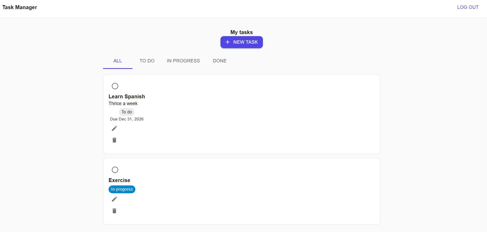
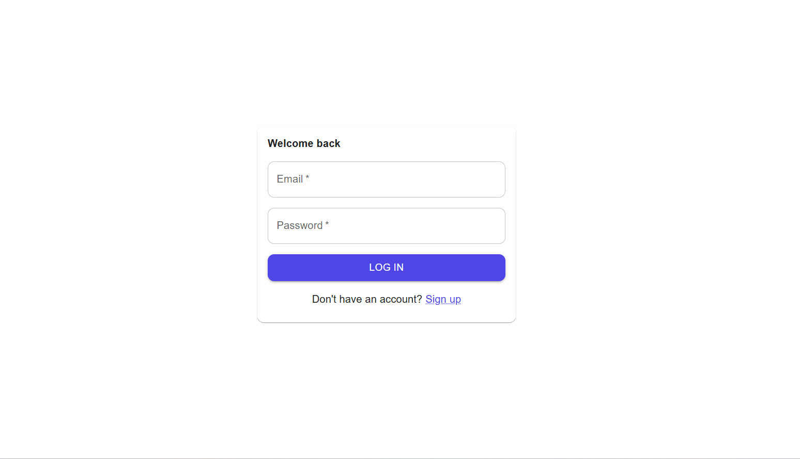
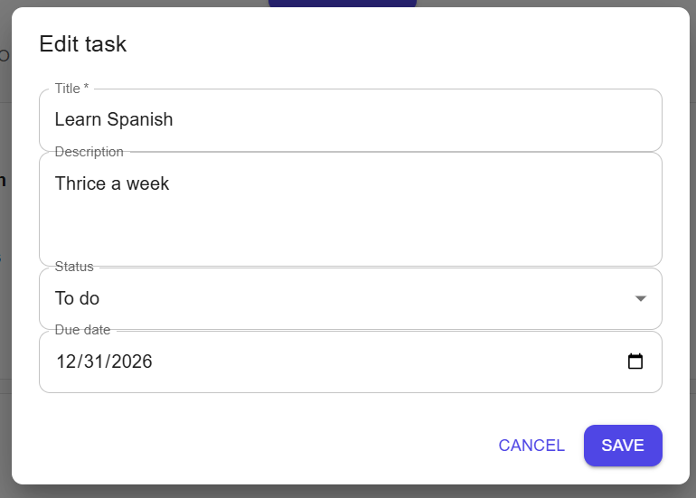

# Task Manager Web

React frontend for the Task Manager app. Sign up, log in, and manage your tasks with a clean Material UI interface.

**Live demo:** coming soon
**API repo:** https://github.com/Tahura-Nafees/task-manager-api



## Features

- Register and log in (JWT stored client-side, protected routes)
- Create, edit, complete and delete tasks
- Filter by status (All / To do / In progress / Done)
- Loading, empty and error states, with confirmation before deleting
- Responsive layout

## Tech stack

React 19, TypeScript, Vite, Material UI, React Router, Axios

## Getting started

1. Install dependencies:
   ```bash
   npm install
   ```
2. Copy `.env.example` to `.env` and set the API URL:
   ```
   VITE_API_URL=http://localhost:3000
   ```
3. Make sure the API is running, then:
   ```bash
   npm run dev
   ```
4. Open http://localhost:5173

## Scripts

`npm run dev` · `npm run build` · `npm run preview` · `npm run lint`

## Screenshots

| Login                    | Create task                |
| ------------------------ | -------------------------- |
|  |  |
